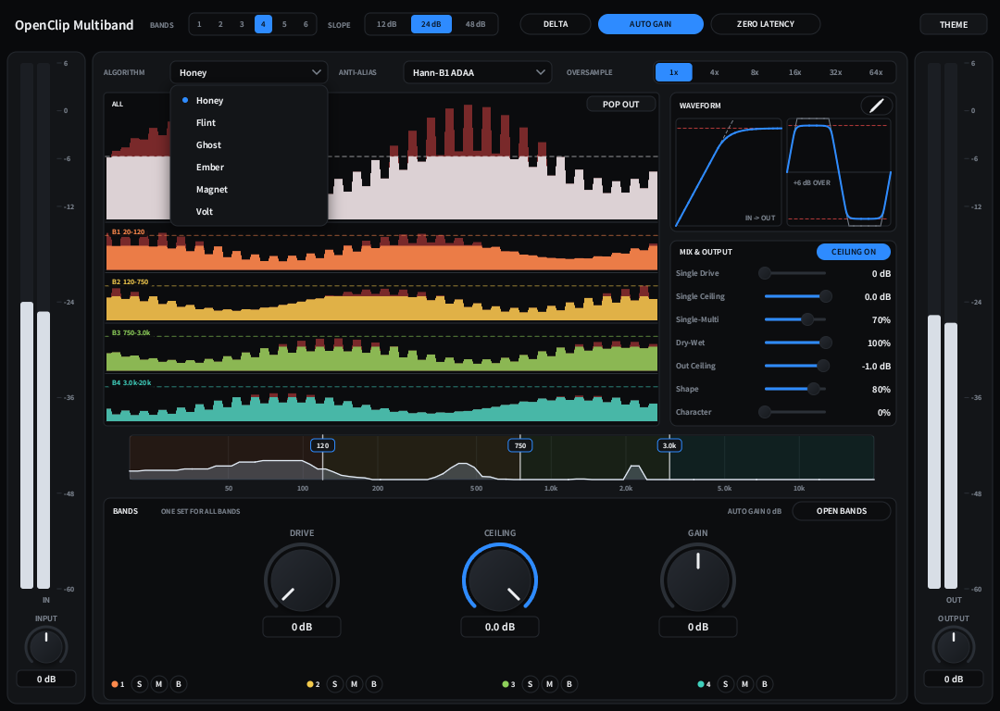

# OpenClip Multiband

**A 1-to-6-band Linkwitz-Riley multiband clipper that blends multiband clipping, single-band clipping and the
dry signal, all phase aligned. Every algorithm runs through Hann-B1 or adaptive ADAA (or none) at 1x to 64x
oversampling, and you can draw your own curve.**
By OpenGrid.


| Drawn curve | Algorithm list | 6 bands (Graphite) |
|---|---|---|
|  |  |  |

## Status

In development, not released. Built from [OpenMultiband](https://github.com/MistaMin/OpenMultiband) 1.0.0 Beta: same
crossover, band routing, Auto Gain, Delta, Zero Latency and editor kit.

## How it works

Input splits through an all-pass-matched Linkwitz-Riley crossover (1 to 6 bands, default 4 at 120 Hz, 750 Hz and
3.00 kHz; 12, 24 or 48 dB/oct). Three paths run side by side:

- **Multi:** every band through its own **Drive** and **Ceiling**, then Band Gain, Solo, Mute and Bypass, summed.
- **Single:** the whole signal through one clipper with its own Drive and Ceiling.
- **Dry:** the unclipped signal.

**Blend** sets Single against Multi, **Mix** sets that against Dry, and the **Output Ceiling** (true-peak safe, -1.0 dB
by default) catches what blending brings back. The three paths are phase aligned: Single and Dry start from the
crossover's matched all-pass signal, which has exactly the band sum's phase, every clipper has the same latency,
and Dry runs through the selected algorithm 60 dB down (where it is linear), so it carries the same small-signal
phase. Any blend adds up without comb filtering, and Delta nulls when nothing clips.

One **Algorithm** (with its **Shape** and **Character**) runs in every clipper. Each algorithm is a static curve
between the stages that make it what it is, and the curve always goes through the selected **Anti-Alias**
method: fitted-slope Hann-B1 ADAA (default, 1 sample), adaptive moving-slope ADAA (0 samples) or none, at
**Oversampling** 1x (default), 4x, 8x, 16x, 32x or 64x. The pencil in the waveform box replaces the curve with
one you draw; the algorithm's stages, the anti-aliasing and the oversampling stay.

| Algorithm | Curve | Stages around it |
|---|---|---|
| Honey | exponential knee (DSP wiki), blended to a parabolic knee by Character | none |
| Flint | hard clip with a quadratic knee (Shape) | none |
| Ghost | hard clip | look-ahead gain that spreads each clip over about 1 ms (61 samples at 48 kHz, times the oversampling) |
| Ember | tanh knee with a bias for even harmonics (Character) | pre/de-emphasis (Shape), 5 Hz DC blocker |
| Magnet | soft saturation | high-frequency emphasis (Character) |
| Volt | soft saturation | overload recovery and output slew limit (Character) |

The Output Ceiling always runs a fixed 8x oversampled engine that holds sample and true peaks.

Latency follows the anti-aliasing and oversampling, never the algorithm: at 48 kHz 125 to 126 samples at 1x and 151
from 4x up (122 / 165 at 44.1 kHz, 174 / 176 at 96 kHz). **Zero Latency** reports 0 and runs adaptive ADAA at
1x (Ghost then runs Honey). CPU at 48 kHz with 6 bands: about 5 % of one core at 1x, 19 % at 4x, 56 % at
16x, two cores at 64x; the high factors are for offline renders.

The editor's history shows the original signal and the clipped result for the whole mix and for each band in its
own colour (red is what was clipped off), and pops out into a resizable window that stays open without the plug-in
window. One Drive / Ceiling / Gain set drives all bands; open the bands to set each one on top of it.

All algorithms and the anti-aliasing are measured on one shared bench (`crates/clip-api`). The design write-ups are
in each `crates/clip-*/REPORT.md` (not in git).

## Build from source

Rust (stable). Builds against [OpenPluginSDK](https://github.com/MistaMin/OpenPluginSDK) and
[GoodLookin DRI](https://github.com/MistaMin/GoodLookinDri) checked out beside it
(`../../Dependencies/OpenPluginSDK`, `../../Dependencies/GoodLookinDri`).

```bash
cargo test --release --workspace   # engines, clip section, plugin and editor tests
./scripts/build.sh                 # macOS universal bundles into dist/ (needs VST3, AU and optional AAX SDKs)
```

Windows and Linux builds run in GitHub Actions (`.github/workflows/build.yml`).
`tools/build_user_manual.py` builds `output/pdf/OpenClipMultiband-User-Manual.pdf`; `scripts/make_installer.sh`
builds, signs and notarizes the macOS `.pkg` installer.

| Folder | Contents |
|---|---|
| `src/` | plugin core, Linkwitz-Riley crossover (`crossover.rs`), Auto Gain, shared telemetry, editor (`src/ui/`) |
| `crates/clip` | the algorithms (`algos.rs`) and one clipper: Drive, algorithm and quality switching, latency padding |
| `crates/clip-api` | the engine contract, the shared ADAA / oversampling stage (`shaper.rs`) and the measurement bench |
| `crates/clip-master` | the output ceiling's 8x engine |
| `crates/clip-soft`, `clip-hard`, `clip-tone`, `clip-analog` | the original design crates the algorithms were ported from |
| `crates/api` | the module contract shared with OpenMultiband |
| `docs/` | user manual, generated parameter reference, editor screenshots |

## License

Source code: MIT, see [LICENSE](LICENSE). Copyright (c) 2026 Marcos Quirino Deida. Official compiled binaries are
proprietary freeware under [BINARY_LICENSE.txt](BINARY_LICENSE.txt). Third-party components and licences:
[THIRD_PARTY_LICENSES.md](THIRD_PARTY_LICENSES.md).

VST is a trademark of Steinberg Media Technologies GmbH. Audio Units is a trademark of Apple Inc. AAX and Pro Tools are
trademarks of Avid Technology, Inc.
