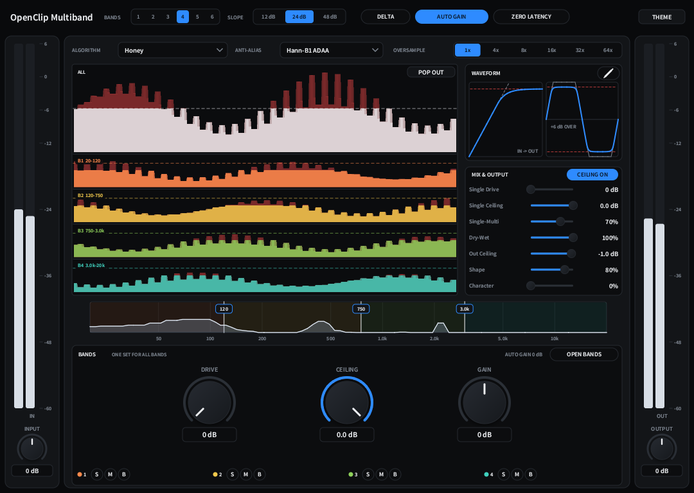
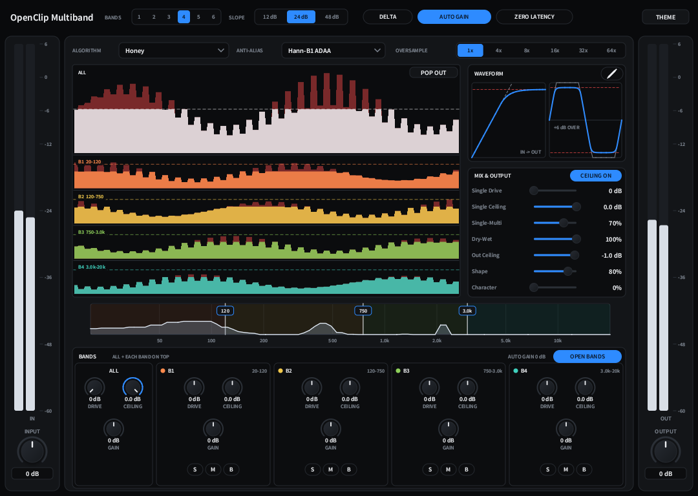
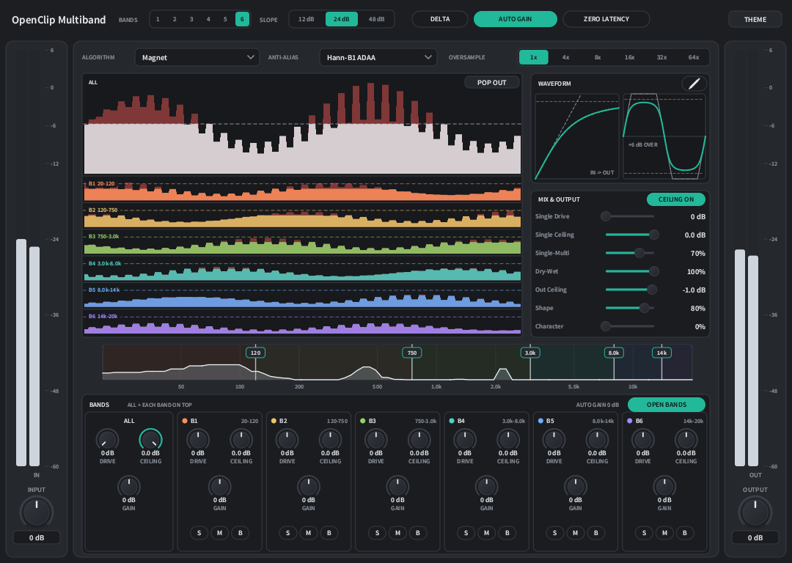
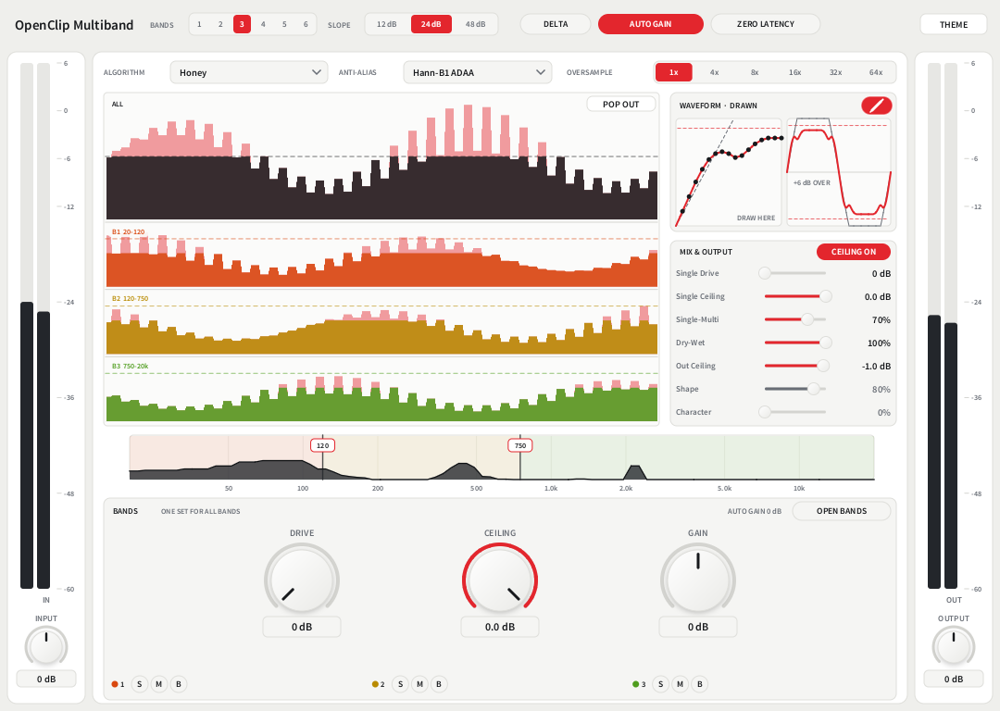

# OpenClip Multiband

**A 1-to-6-band multiband clipper that blends multiband clipping, single-band clipping and the dry signal, all phase
aligned, with six algorithms through ADAA and up to 64x oversampling, and a curve you can draw yourself.**
By OpenGrid.



| Drawn curve | Bands open | 6 bands, Magnet (Graphite) | Light theme |
|---|---|---|---|
|  |  |  |  |

## Version 1.0.0 Beta

- Three phase-aligned paths: per-band clipping (Multi), full-band clipping (Single) and Dry, with Single-Multi and
  Dry-Wet blends, then a true-peak Output Ceiling (-1.0 dB).
- Six algorithms (Honey, Flint, Ghost, Ember, Magnet, Volt), each through fitted-slope Hann-B1 ADAA, adaptive ADAA or
  none, at 1x, 4x, 8x, 16x, 32x or 64x oversampling. Or draw your own curve.
- One Drive / Ceiling / Gain set for all bands that opens into each band's own offsets (±24 dB).
- A large history of the original against the clipped signal, the whole mix and each band in its own colour, that pops
  out into a resizable window of its own.
- Auto Gain, Delta, Zero Latency and seven themes.

## Download

From the [1.0.0 Beta release](https://github.com/MistaMin/OpenClipMultiband/releases/tag/v1.0.0-beta):

| Download | System | Formats |
|---|---|---|
| [`OpenClipMultiband-1.0.0-Beta-macos.pkg`](https://github.com/MistaMin/OpenClipMultiband/releases/download/v1.0.0-beta/OpenClipMultiband-1.0.0-Beta-macos.pkg) | macOS 11 or later, Apple silicon and Intel (universal) | VST3, Audio Unit, CLAP, LV2, AAX |
| [`OpenClipMultiband-1.0.0-Beta-windows-x64-setup.exe`](https://github.com/MistaMin/OpenClipMultiband/releases/download/v1.0.0-beta/OpenClipMultiband-1.0.0-Beta-windows-x64-setup.exe) | Windows 10 or later, x64 | VST3, CLAP, LV2 |
| [`OpenClipMultiband-1.0.0-Beta-linux-x86_64.tar.gz`](https://github.com/MistaMin/OpenClipMultiband/releases/download/v1.0.0-beta/OpenClipMultiband-1.0.0-Beta-linux-x86_64.tar.gz) | Linux x86_64 (glibc 2.35+) | VST3, CLAP, LV2 |
| [`OpenClipMultiband-User-Manual.pdf`](https://github.com/MistaMin/OpenClipMultiband/releases/download/v1.0.0-beta/OpenClipMultiband-User-Manual.pdf) | All systems | User manual and parameter reference |

The macOS installer lets you choose any combination of VST3, Audio Unit, CLAP, LV2 and AAX, and installs the manual and
licences into `/Library/Application Support/OpenClipMultiband`. It is signed with Developer ID and notarized by Apple;
the AAX bundle is digitally signed with PACE Eden for Pro Tools. The Windows installer is not code-signed, so
SmartScreen may ask before it runs.

**Limits of this release:** Windows and Linux binaries are built by GitHub Actions and passed the automated tests only,
not a DAW host; no standalone app; Logic Pro has not been tested.

## User guide

- [User manual](docs/USER_MANUAL.md) (PDF in each release) and [parameter reference](docs/PARAMETERS.md)
- [Changelog](CHANGELOG.md) and [release notes](RELEASE_NOTES.md)

## How it works

Input splits through an all-pass-matched Linkwitz-Riley crossover (1 to 6 bands, default 4 at 120 Hz, 750 Hz and
3.00 kHz; 12, 24 or 48 dB/oct). Three paths run side by side:

- **Multi:** every band through its own Drive and Ceiling, then Band Gain, Solo, Mute and Bypass, summed.
- **Single:** the whole signal through one clipper with its own Drive and Ceiling.
- **Dry:** the unclipped signal.

**Single-Multi** sets Single against Multi, **Dry-Wet** sets that against Dry, and the **Output Ceiling** (true-peak
safe, -1.0 dB by default) catches what blending brings back. The paths are phase aligned: Single and Dry start from the
crossover's matched all-pass signal, which has exactly the band sum's phase; every clipper has the same latency; and
Dry runs through the selected algorithm with a straight-line curve, so it carries the same anti-aliasing and
oversampling filters. Any blend adds up without comb filtering, and Delta is silent when nothing clips.

One **Algorithm** (with its **Shape** and **Character**) runs in every clipper. Each is a static curve between the
stages that make it what it is, and the curve always goes through the selected **Anti-Alias** method: fitted-slope
Hann-B1 ADAA (default), adaptive moving-slope ADAA or none, at **Oversample** 1x (default) to 64x. The pencil in the
waveform box replaces the curve with one you draw; the stages, the anti-aliasing and the oversampling stay.

| Algorithm | Curve | Stages around it |
|---|---|---|
| Honey | exponential knee, blended to a parabolic knee by Character | none |
| Flint | hard clip with a quadratic knee (Shape) | none |
| Ghost | hard clip | look-ahead gain that spreads each clip over about 1 ms |
| Ember | tanh knee with a bias for even harmonics (Character) | pre/de-emphasis (Shape), 5 Hz DC blocker |
| Magnet | soft saturation rising to the ceiling, knee set by Shape | high-frequency emphasis (Character) |
| Volt | soft saturation rising to the ceiling, knee set by Shape | overload recovery and output slew limit (Character) |

Latency follows the anti-aliasing and oversampling, never the algorithm: at 48 kHz 125 to 126 samples at 1x and 151
from 4x up. **Zero Latency** reports 0 and runs adaptive ADAA at 1x. CPU at 48 kHz with 6 bands: about 5 % of one core
at 1x, 19 % at 4x, 56 % at 16x; 32x and 64x are for offline renders.

## Build from source

Rust (stable). Builds against [OpenPluginSDK](https://github.com/MistaMin/OpenPluginSDK) and
[GoodLookin DRI](https://github.com/MistaMin/GoodLookinDri) checked out beside it
(`../../Dependencies/OpenPluginSDK`, `../../Dependencies/GoodLookinDri`; revisions in `scripts/build.sh`).

```bash
cargo test --release --workspace   # algorithms, clip section, plugin and editor tests
./scripts/build.sh                 # macOS universal bundles into dist/ (needs VST3, AU and optional AAX SDKs)
```

Windows and Linux builds run in GitHub Actions (`.github/workflows/build.yml`). `tools/build_user_manual.py` builds
`output/pdf/OpenClipMultiband-User-Manual.pdf`; `scripts/make_installer.sh` builds, signs and notarizes the macOS
`.pkg` installer.

| Folder | Contents |
|---|---|
| `src/` | plugin core, Linkwitz-Riley crossover (`crossover.rs`), Auto Gain, value text, shared telemetry, editor (`src/ui/`) |
| `crates/clip` | the algorithms (`algos.rs`) and one clipper: Drive, algorithm and quality switching, latency padding |
| `crates/clip-api` | the engine contract, the shared ADAA and oversampling stage (`shaper.rs`) and the measurement bench |
| `crates/clip-master` | the Output Ceiling's 8x engine |
| `crates/clip-soft`, `clip-hard`, `clip-tone`, `clip-analog` | the first design engines the algorithms were ported from |
| `crates/api` | the module contract shared with OpenMultiband |
| `docs/` | user manual, generated parameter reference, editor screenshots |
| `qa/` | test ledgers and host-suite reports |

## License

Source code: MIT, see [LICENSE](LICENSE). Copyright (c) 2026 Marcos Quirino Deida. Official compiled binaries are
proprietary freeware under [BINARY_LICENSE.txt](BINARY_LICENSE.txt). Third-party components and licences:
[THIRD_PARTY_LICENSES.md](THIRD_PARTY_LICENSES.md).

VST is a trademark of Steinberg Media Technologies GmbH. Audio Units is a trademark of Apple Inc. AAX and Pro Tools are
trademarks of Avid Technology, Inc.
