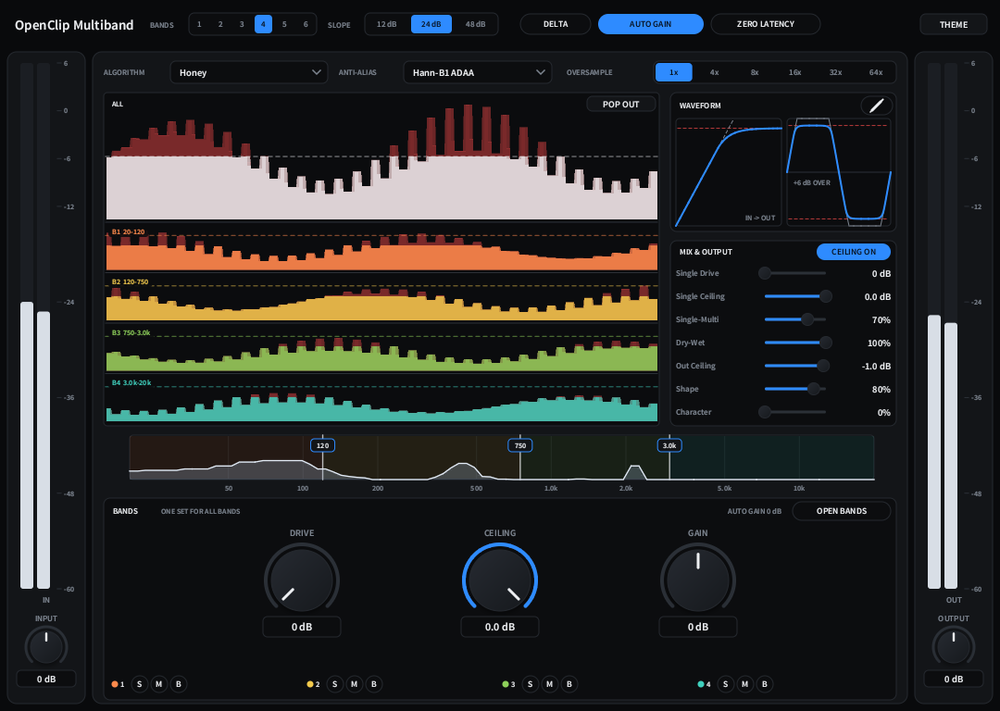

# OpenClip Multiband User Manual

OpenClip Multiband is a 1-to-6-band multiband clipper by OpenGrid. It clips the signal three ways at once (per
band, as one full band, and not at all), lets you blend the three, phase aligned, and finishes with an output
ceiling. Every algorithm runs through the anti-aliasing you choose, and you can draw your own curve.

## Signal flow

- **Input Gain** into the **Linkwitz-Riley Crossover** (1 to 6 bands, 12 / 24 / 48 dB/oct).
- **Multi:** per band **Drive** -> **Clipper** at the band's **Ceiling** -> **Band Gain / Bypass / Solo / Mute**, summed.
- **Single:** the full-band signal -> **Drive** -> **Clipper** at the single **Ceiling**.
- **Dry:** the full-band signal, unclipped.
- **Blend** (Single to Multi) -> **Mix** (Dry to Wet) -> **Output Ceiling** -> **Output Gain** -> **Delta** -> **Auto Gain** -> **Output**.

### Why the blend never phases

Mixing a clipped signal with another version of itself only adds up cleanly if both have the same phase at every
frequency. Below the ceiling the three paths are the same signal:

- The crossover makes a full-band copy of the input through the same all-pass filters its bands use, so the Single
  and Dry paths start with exactly the phase of the summed bands.
- Every clipper has the same latency, whatever the algorithm.
- The anti-aliasing and oversampling filters shift the phase of the top end slightly. The Dry path runs through the
  same algorithm, anti-aliasing and oversampling with a straight-line curve, so it carries the same shift.

So Blend and Mix only change how much clipping you hear, never the tone of the unclipped part, and **Delta** is
silent when nothing clips.

New instances start with 4 bands (120 Hz, 750 Hz, 3.00 kHz, 24 dB/oct), **Honey** (Shape 80 %, Character
0 %), **Hann-B1 ADAA** at **1x**, every Drive 0 dB and Ceiling 0 dB, the band panel closed (one set for all bands), Blend 100 % (all
Multi), Mix 100 % (all wet) and the Output Ceiling on at -1.0 dB.

The algorithms are **Honey** (soft exponential knee), **Flint** (hard clip), **Ghost** (look-ahead smooth
clip), **Ember** (tone-shaped, even harmonics), **Magnet** (soft saturation driven harder on highs) and **Volt**
(soft saturation with overload recovery and slew).

## The window

- **Header:** **Bands** (1 to 6), **Slope**, **DELTA**, **AUTO GAIN**, **ZERO LATENCY** and **THEME**.
- **Volts:** stereo input and output peak meters with the **Input** and **Output** gain knobs (-24 to 24 dB).
- **Algorithm row:** **Algorithm** list, **Anti-Alias** list and **Oversample** (1x, 4x, 8x, 16x, 32x, 64x). They
  apply to every clipper.
- **History** (the large view): the last three seconds. **ALL** on top is the dry input against the final output.
  Below it every band has its own lane in its own colour: the band's signal after Drive against what its clipper
  made of it. Each lane shows half the waveform: the level on either side, folded up from the lane's floor, so it
  stands twice as tall and transients keep their shape. The solid fill is the result, the red above it is what was
  clipped off, and the dashed line is that lane's ceiling. Each lane scales to its loudest recent input, but never closer than the ceiling.
  **POP OUT** opens the history in a window of its own (below).
- **Waveform box:** on the left the curve (input across, output up, both in units of the ceiling; the curve is
  odd, so only the positive half is shown; the dashed red line is the ceiling, the grey diagonal is no change). On
  the right one cycle of a sine 6 dB over the ceiling and what the curve makes of it. The pencil button switches to
  your own curve (next section).
- **Crossover strip:** input and output spectrum, the band regions and the crossover handles (drag one; double-click
  it to type a frequency).
- **Bands** (bottom): one set of large **Drive**, **Ceiling** and **Gain** knobs for all bands, and **S** (solo),
  **M** (mute), **B** (bypass) for each band. **OPEN BANDS** shows an ALL column and a column per band (below).
- **Mix & Output** sliders (under the waveform box), with **Ceiling On** for the Output Ceiling: **Single Drive** and **Single Ceiling** (the full-band clipper), **Single-Multi** (0 % =
  all Single, 100 % = all Multi), **Dry-Wet** (0 % = all Dry), **Out Ceiling**, and the algorithm's **Shape** and
  **Character**.

Drag a knob, scroll over it, or double-click it to type a value.

## Algorithms

| Algorithm | Shape | Character |
|---|---|---|
| **Honey** | Where the knee starts: 20 dB under the ceiling at 0 %, 2.2 dB at 80 %, 0.45 dB at 100 % | 0 %: exponential knee that never quite reaches the ceiling; 100 %: parabolic knee that reaches it, louder |
| **Flint** | Knee width, from razor-hard (0 %) to rounded | no effect |
| **Ghost** | Knee of the look-ahead gain: hard at 0 %, starting 6 dB under the ceiling at 100 % | Extra recovery after a peak, up to 30 ms: less distortion on bass |
| **Ember** | Emphasis: highs reach the curve up to 12 dB louder, so they clip first and the distortion comes out darker | Even harmonics (asymmetry); a 5 Hz DC blocker follows |
| **Magnet** | Softness: the saturation starts 4.4 dB under the ceiling at 0 %, from the first sample at 100 % | How much harder frequencies above 1.8 kHz are driven, up to +9.5 dB |
| **Volt** | Softness, as Magnet | Recovery after overload (30 to 2 ms) and output slew limit (8 to 80 kHz) |

Magnet and Volt saturate rather than hit a hard ceiling: their curve rises towards the ceiling without quite reaching
it. A sine 6 dB over comes out 0.1 dB under the ceiling at Shape 0 %, 0.5 dB at 50 % and 1 dB at 100 %; Volt's
overload recovery takes it a little lower. Ghost on steady tones above
about 500 Hz behaves like a 1 ms limiter rather than a waveshaper; its character shows on bass and mixed material.

Switching the algorithm crossfades over 10 ms.

## Anti-aliasing and oversampling

Clipping creates harmonics above half the sample rate that fold back as inharmonic tones. Every algorithm's curve
goes through the **Anti-Alias** method, and the whole algorithm runs at the **Oversample** factor.

| Anti-Alias | What it does | Latency of its own |
|---|---|---|
| **Hann-B1 ADAA** (default) | Fitted-slope Hann-B1 antiderivative anti-aliasing: the strongest 1x alias rejection, an exact zero on Nyquist aliases | 1 sample at the processing rate |
| **Adaptive ADAA** | Adaptive moving-slope antiderivative anti-aliasing: the most accurate harmonics and high end | 0 |
| **No ADAA** | The plain curve | 0 |

Measured on a hard clip, 5 kHz tone 12 dB over the ceiling at 48 kHz: no ADAA -30 dBc of aliasing, Hann-B1 -46,
adaptive -43; no ADAA at 4x -56, at 16x -79; Hann-B1 at 16x -109.

Both ADAA methods can overshoot the ceiling a little on loud high-frequency material (by design: they rebuild the
waveform between samples). The Output Ceiling holds the final level.

Oversampling runs the whole algorithm (its stages too) at 4x to 64x between linear-phase half-band filters. It
costs CPU roughly in proportion: at 48 kHz with 6 bands about 5 % of one core at 1x, 19 % at 4x, 56 % at 16x and two
cores at 64x. Use 32x and 64x for offline renders. Changing Anti-Alias or Oversample fades the output for 5 ms while
the clippers are reconfigured.

## Drawing your own curve

Click the **pencil** in the waveform box. The first time, the drawn curve starts as a copy of the selected
algorithm's curve. Drag in the curve view to draw: across is the input (up to twice the ceiling), up is the output
(up to the ceiling). The curve is odd: what you draw is mirrored for the negative half of the wave. It has 16 points, joined by
straight lines, and stays flat after the last one.

While the pencil is on, every clipper (bands and single) uses your curve in place of the algorithm's curve. The
algorithm's stages (Ember's emphasis, Ghost's look-ahead, Volt's slew, Magnet's emphasis), the anti-aliasing and the
oversampling all still apply; **Shape** and **Character** are greyed out and the stages run at the algorithm's usual
settings. Click the pencil again to go back to the algorithm's curve; your
drawing is kept for next time and saved with the session.

## Bands: one set, or each band

The band panel starts closed: one **Drive**, **Ceiling** and **Gain** set that every band uses. **OPEN BANDS** shows
the **ALL** set next to a column per band. A band's knobs are offsets from ALL, 0 in the middle, -24 to +24 dB: a band
at Drive +4 dB with ALL at +6 dB is driven 10 dB, a band at -6 dB under ALL at +6 dB is not driven at all. So each
band can be pushed or pulled up to 48 dB: Drive runs from -24 to +48 dB in total, Gain from -48 to +48 dB, and the
Ceiling from 0 dBFS down (it never goes above 0 dBFS; the clippers stop at -40 dB). The offsets start at 0, so
opening or closing the panel changes nothing you hear.

## The history in its own window

**POP OUT** (top right of the history) opens the history in a window of its own. Drag its edges to make it as
large as you like (up to 4096 points wide, where it shows about 20 seconds); it remembers where it was and how large. It belongs to the plug-in, not to the plug-in window:
it keeps running when you close the plug-in window, and closes when you remove the plug-in. Click **POP OUT** again
(or close the window) to close it.

## Latency

Latency follows the anti-aliasing and oversampling, never the algorithm (every clipper pads every algorithm to the
slowest one):

| Rate | 1x (Hann-B1) | 1x (adaptive or none) | 4x to 64x |
|---|---:|---:|---:|
| 44.1 kHz | 122 | 121 | 164 to 165 |
| 48 kHz | 126 | 125 | 151 |
| 96 kHz | 174 | 173 | 176 |

That includes 64 samples for the Output Ceiling, kept when it is off. With **Zero Latency** on, the plugin reports 0
and every clipper runs adaptive ADAA at 1x; Ghost (which needs look-ahead) runs Honey instead.

## Suggested start

Leave Blend at 100 % and work the one band set: add Drive or lower the Ceiling until the history shows red on the
peaks you want to tame, then open the bands to push or spare single bands. Turn Blend down to hear the single
clipper take over the loudest moments as one, and turn Wet down to bring back transients from the dry signal. The
Output Ceiling catches what the blend brings back.

Output Gain and Auto Gain come after the Output Ceiling: raising either one can take the output above it. Raise
level with Drive, not Output Gain, when the ceiling must hold.

## Global controls

| Control | What it does |
|---|---|
| Input Gain, Output Gain | Level into the crossover and out of the Output Ceiling, -24 to 24 dB |
| Bands | Active band count, 1 to 6 (default 4). Switching dips the output smoothly for 5 ms |
| Crossover Slope | 12 dB, 24 dB (default) or 48 dB per octave |
| Crossover 1 to 5 | Split frequencies, 20.0 Hz to 20.0 kHz (defaults 120 Hz, 750 Hz, 3.00 kHz, 8.00 kHz, 14.0 kHz) |
| Zero Latency | Reports 0 samples latency (see Latency) |
| Auto Gain | Matches output loudness to the input (BS.1770, three-second average, up to ±24 dB). A listening aid: switch off before printing |
| Delta | Plays only what the clipping changed: output minus the aligned dry signal. Switch off before printing |

## Formats

- **macOS 11 or later (Apple silicon and Intel):** VST3, Audio Unit, CLAP, LV2 and AAX.
- **Windows 10 or later (x64):** VST3, CLAP and LV2.
- **Linux (x86_64):** VST3, CLAP and LV2.
- No standalone application.

Tested on macOS in REAPER (VST3, CLAP, Audio Unit), OpenGrid9 (VST3, Audio Unit, LV2) and Pro Tools Studio 2025.10
(AAX). Windows and Linux builds pass the automated tests but have not been tested in a host; Logic Pro has not been
tested.

## Licence

Every parameter with its range and default is listed in the parameter reference (`docs/PARAMETERS.md`).

Source code is MIT licensed (`LICENSE`). Official compiled binaries are proprietary freeware under `BINARY_LICENSE.txt`.
Third-party components and licences are listed in `THIRD_PARTY_LICENSES.md`. Copyright (c) 2026 Marcos Quirino Deida.

VST is a trademark of Steinberg Media Technologies GmbH. Audio Units is a trademark of Apple Inc.
AAX and Pro Tools are trademarks of Avid Technology, Inc.
